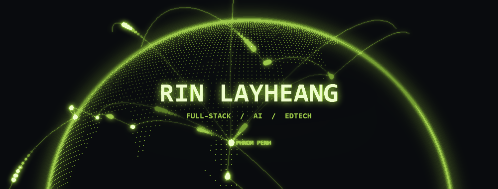
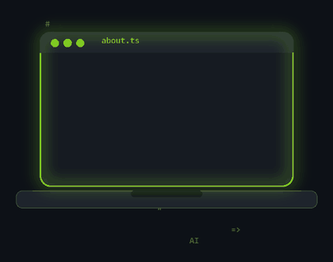
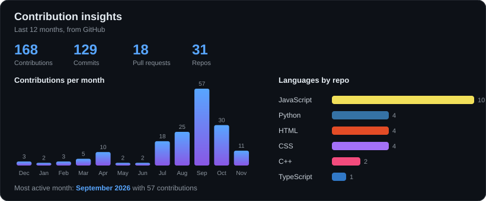
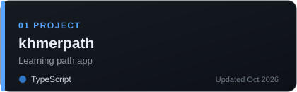
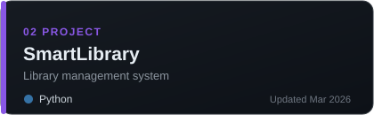
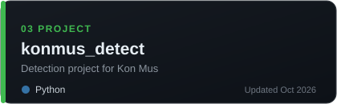
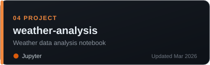
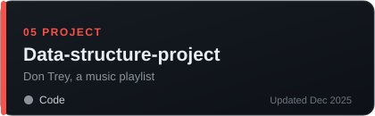
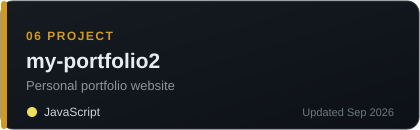

  

 

 

## About

<table>
<tr>
<td width="55%" valign="middle">

Hi, I'm **Rin Layheang**, a **Year 2 Computer Science** student at **CADT** (Cambodia Academy of Digital Technology) in Phnom Penh, Cambodia.

I like building web apps and exploring **AI, EdTech and data science**. I speak **Khmer and English**, and I'm open to collaboration.

- Learning JavaScript, TypeScript, React, Python and C++
- Making Khmer data science lessons as Kon Mus
- Working on projects like Sala AI / MathMate

</td>
<td width="45%" align="center">

</td>
</tr>
</table>

  

  

 

## Stack

  

 

## Selected work

<table width="100%">
<tr>
<td width="50%" align="center"></td>
<td width="50%" align="center"></td>
</tr>
<tr>
<td width="50%" align="center"></td>
<td width="50%" align="center"></td>
</tr>
<tr>
<td width="50%" align="center"></td>
<td width="50%" align="center"></td>
</tr>
</table>

 

## Contact

  

